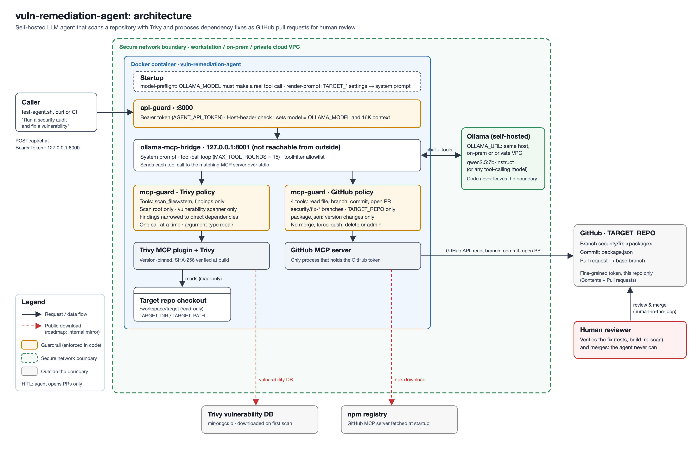

# vuln-remediation-agent
## Autonomous DevSecOps via Self-Hosted LLMs & Model Context Protocol (MCP)
The `vuln-remediation-agent` is a **Privacy-First** autonomous remediation agent. It leverages a self-hosted LLM served by **Ollama** inside your secure network boundary (workstation, on-prem, or private cloud VPC; any tool-calling model, [configurable](#switching-models)) to analyze vulnerability reports from **Trivy** and propose dependency fixes as **GitHub pull requests** for a human to review and merge.

Built with **Healthcare and Financial Services** requirements in mind, this architecture keeps proprietary source code and vulnerability data away from third-party LLM providers.

## Why This Architecture?
In traditional enterprise environments, security is often a reactive **"Context-Switching Tax."** Tools like `npm audit` or Nexus IQ identify risks but leave the high-friction work of triage and remediation to the developer, slowing down velocity and leaving windows of vulnerability open. Furthermore, standard AI security solutions introduce **"Data Exit"** risks by sending proprietary codebases to public LLM APIs, a non-starter for high-compliance sectors like Healthcare and Finance.

The **vuln-remediation-agent** solves these challenges by shifting the paradigm from **Reactive Detection to Proactive Immunity**:
- **Ensures Data Privacy:** All reasoning runs on a self-hosted model inside your secure network boundary, whether on a workstation, on-prem, or in a private cloud network; source code and vulnerability data are never sent to a third-party LLM provider.
- **Proactive Remediation:** Instead of waiting for a post-build alert, the agent identifies vulnerable dependencies and proposes the fix as a ready-to-review pull request. It moves the needle from "Shift-Left Detection" to **"Shift-Left Correction."**
- **Human-in-the-Loop by Design:** The agent can only open pull requests. Merging is always a human decision, enforced in code rather than by prompt instructions (see [Security & Privacy](#security--privacy)).
- **Reproducible Infrastructure:** Fully containerized via Docker Compose, with pinned and checksum-verified tooling.
- **Zero-Friction DevSecOps:** The agent acts as a "Digital Pair Programmer" that handles the grunt work of identifying "Policy-Clean" versions and preparing PRs, allowing engineers to stay in the "flow state" and focus on feature delivery rather than security debt.

## Architecture


*Source: [`assets/agent_archi.svg`](./assets/agent_archi.svg).*

### Key Components:
* **Reasoning Engine:** Self-hosted LLM via Ollama (hardware accelerated), on the same machine or anywhere in your private network. Any tool-calling model via `OLLAMA_MODEL`; `qwen2.5:7b-instruct` is recommended (see [tested models](#switching-models)).
* **API gateway:** [`api-guard`](./api-guard/api-guard.js) authenticates every request, pins the model and context size, and is the only way into the agent.
* **Orchestration:** `ollama-mcp-bridge` runs the tool-calling loop between the model and the MCP servers.
* **Security Scanner:** [Trivy MCP plugin](https://github.com/aquasecurity/trivy-mcp) for filesystem vulnerability discovery.
* **GitOps:** GitHub MCP Server for branch creation, commits and PR creation.
* **Guardrails:** [`mcp-guard`](./mcp-guard/mcp-guard.js), an allowlist proxy in front of both MCP servers that enforces Human-in-the-Loop and least privilege.
* **Startup checks:** [`model-preflight`](./scripts/model-preflight.js) verifies the model can make tool calls; [`render-prompt`](./scripts/render-prompt.js) fills the configured target repository into the [prompt template](./agent_prompt.md).

The agent operates on an **Observe-Orient-Decide-Act (OODA)** loop:

- **Observe:** Runs a Trivy scan of the target project to identify CVEs and their "Fixed Versions."
- **Orient:** Narrows the findings to direct dependencies (the ones a `package.json` change can fix); the guard does this deterministically from `package.json`.
- **Decide:** The model picks the package and target version, avoiding breaking major upgrades unless they are needed to fix the CVEs.
- **Act:** Reads `package.json` via GitHub MCP, commits the version change to a `security/fix-*` branch (checked by the guard), and opens a PR with a security summary for human review.


## Tech Stack
- **AI Brain:** Qwen 2.5 7B (recommended), Llama 3.1 (default), or another tool-calling model via [Ollama](https://ollama.com/)
- **Protocol:** [Model Context Protocol (MCP)](https://modelcontextprotocol.io/docs/getting-started/intro)
- **Security Scanner:** [Trivy](https://trivy.dev/) (Open Source SCA)
- **Automation:** GitHub API (via MCP Server)
- **Runtime:** Python (MCP bridge), Node.js (GitHub MCP server, `api-guard`, `mcp-guard`, startup scripts)

## Getting Started
1. **Prerequisites**

  - Docker & Docker Compose installed.
  - **GitHub PAT:** A [fine-grained personal access token](https://github.com/settings/personal-access-tokens/new) scoped to **only the target repository** ("Only select repositories"; by default this repository, for its demo app), with these repository permissions and nothing else:
    - **Contents:** Read and write
    - **Pull requests:** Read and write

    Do not grant administration or any other permissions, and do not use a classic token with the `repo` scope: it grants write access to every repository you can reach.

  - **Ollama server** reachable from the agent over a private network: on the same machine (the default), on-prem, or on a GPU host in your private cloud network. Set its address with `OLLAMA_URL` (see [Ollama location](#ollama-location)).

    *Note: For Apple Silicon users running everything on one machine, it is recommended to run Ollama natively on the Mac to take advantage of Metal GPU acceleration, while the **vuln-remediation-agent** runs containerized via Docker Compose.*
2. **Configuration**

    Copy `.env.example` to `.env` in the root directory, add your GitHub token, generate an API token (`openssl rand -hex 32`) that callers of the agent must present, and choose the model:
    ```
    GITHUB_TOKEN=your_fine_grained_pat_here
    AGENT_API_TOKEN=output_of_openssl_rand_hex_32
    OLLAMA_MODEL=qwen2.5:7b-instruct
    ```
    The agent refuses to start without an `AGENT_API_TOKEN` of at least 32 characters. To target a repository other than the demo app, see [Use it on another repository](#use-it-on-another-repository).

3. **Launch the Agent**
    - Make sure your Ollama server (on this machine or in your private network) is running and has the model downloaded:
        ```bash
        ollama pull qwen2.5:7b-instruct    # the model you set in OLLAMA_MODEL
        ```

    - Start the agent:
        ```bash
        # Start the containers
        docker compose up -d

        # Verify the agent: the model preflight must report "OK" before the bridge starts
        docker logs -f vuln-remediation-agent
        ```
    - Test your Agent (or run `bash test-agent.sh`, which reads the token from `.env`)
        ```
        curl -X POST http://localhost:8000/api/chat \
            -H "Authorization: Bearer $AGENT_API_TOKEN" \
            -H "Content-Type: application/json" \
            -d '{
                "messages": [{"role": "user", "content": "Run a security audit and fix the most severe vulnerability in a direct dependency: one branch and one pull request."}],
                "stream": false
            }'
        ```
        A run takes a few minutes. `docker logs vuln-remediation-agent` shows every tool call the agent makes, and every call the guard blocks.
    - [Review the pull request](#reviewing-the-agents-pull-request) the agent opens on GitHub, and merge it yourself if the fix is correct.

## Reviewing the agent's pull request
The agent changes only the version in `package.json`. Before merging, verify the fix on the PR branch:
```bash
git fetch origin && git switch security/fix-<package>
cd <TARGET_PATH>
npm install                                   # updates package-lock.json to the new version
npm ls <package>                              # confirms the version actually installed
CI=true npm test -- --watchAll=false && npm run build
docker exec vuln-remediation-agent trivy fs --scanners vuln --severity HIGH,CRITICAL \
  --skip-dirs /workspace/target/<TARGET_PATH>/node_modules /workspace/target/<TARGET_PATH> | grep -i <package>
```
`docker exec` scans what is mounted at `/workspace/target`, i.e. your local checkout (`TARGET_DIR`), so run it with the PR branch checked out there.

If the scan still lists CVEs for the package, the chosen version doesn't fix all of them: pick the version that does (the highest "fixed in" version on the line you need), reinstall, and re-run the checks. Commit the updated `package-lock.json` to the branch before merging.

## Deployment options
The same container runs wherever Docker does; only `OLLAMA_URL` and the target settings change:

- **Developer Workstation:** Runs as a background service on Apple Silicon or NVIDIA-enabled workstations, with Ollama on the same machine.
- **Private Cloud (AWS/Azure/GCP):** Ollama runs on a GPU-enabled instance (e.g., EC2 g5.xlarge) in a private subnet of your VPC, and the agent reaches it via `OLLAMA_URL` without the traffic leaving your network.
- **On-Prem / CI (planned):** Run the agent alongside CI/CD runners (Jenkins/GitLab) to propose fixes during the build phase. Packaging for Kubernetes is not included yet.

## Use it on another repository
The target repository is configuration, not code: nothing in the agent names a repository. By default it remediates this repo's demo app (`my-demo-app`). To point it at your own npm project:

1. Clone your repository next to this one and check out its base branch.
2. Create a fine-grained GitHub token scoped to **that repository only** (Contents and Pull requests: read/write).
3. Set the target in `.env`:
   ```
   GITHUB_TOKEN=<token for your repository>
   TARGET_REPO=your-org/your-repo
   TARGET_BRANCH=main
   TARGET_PATH=.             # directory containing package.json ("." for the repository root)
   TARGET_DIR=../your-repo   # your local clone; mounted read-only and scanned
   ```
4. Run `docker compose up -d --force-recreate`.

At startup the agent fills these values into its prompt ([`agent_prompt.md`](./agent_prompt.md) is a template), scans `TARGET_DIR/TARGET_PATH`, and opens PRs against `TARGET_REPO`. The guard rejects GitHub calls for any other repository, even if the token could reach it.

**Current scope:** npm projects with one `package.json` per target. Other ecosystems, monorepos, and fixes grouped across packages are on the [roadmap](./docs/bounded-network-plan.md).

## Ollama location
By default the agent uses Ollama on the Docker host (`http://host.docker.internal:11434`). To use an Ollama server elsewhere in your private network, set `OLLAMA_URL` in `.env` or per run:
```bash
OLLAMA_URL=http://ollama.internal:11434 docker compose up -d
```
If that server sits behind an authenticating gateway, add the headers it needs as a JSON object; the bridge and the startup preflight both send them on every Ollama request:
```
UPSTREAM_HEADERS={"Authorization": "Bearer your_gateway_token"}
```
Use only private-network addresses: every prompt contains source code and vulnerability data. See [Security & Privacy](#security--privacy).

## Switching models
The agent works with any Ollama-served model that supports **tool (function) calling**. Set it with `OLLAMA_MODEL` (default: `llama3.1`; recommended: `qwen2.5:7b-instruct`), either per run:
```bash
ollama pull qwen2.5:7b-instruct
OLLAMA_MODEL=qwen2.5:7b-instruct docker compose up -d
```
or permanently in `.env` (`OLLAMA_MODEL=qwen2.5:7b-instruct`). Pull the model in Ollama first.

`OLLAMA_MODEL` is the single source of truth: `api-guard` sets it as the `model` of every `/api/chat` request, so any `model` a caller sends is ignored. It also sets the context window to `OLLAMA_NUM_CTX` (default 16384 tokens): Ollama's 4096-token default is smaller than one Trivy findings list, and an overflowing context silently drops the agent's instructions. `MAX_TOOL_ROUNDS` (default 15) stops a model that keeps retrying.

**Startup preflight.** Before the bridge starts, [`scripts/model-preflight.js`](./scripts/model-preflight.js) sends the model one request with a single dummy tool and checks that it answers with a well-formed, structured tool call. If it doesn't, the container exits immediately with:
```
[model-preflight] FAILED: Model <name> does not appear to support tool calling via Ollama — try a different model/tag.
```
followed by the reason (no `tools` capability, replied in plain text, wrong tool name or arguments). Without this check, a model that answers in plain text makes the agent "finish" without doing anything and without any error. The check also fails clearly if Ollama is unreachable, the model isn't pulled, or it is too large to load in time. Run it on its own with `OLLAMA_MODEL=<model> node scripts/model-preflight.js`.

**Tested models** (Apple M4 Pro, 24 GB, October 2026)

| Model | Preflight | Full remediation run |
|---|---|---|
| `qwen2.5:7b-instruct` | Pass | **Recommended.** Scans, finds the vulnerable direct dependency on its own, then branch, commit and PR. Once chose a version that fixed only some of the CVEs, which [review](#reviewing-the-agents-pull-request) caught. |
| `llama3.1` (8B) | Pass | Unreliable: often described tool calls in text, or sent all calls at once with placeholder values. Tested before the 16K context fix; worth retesting. |
| `llama3.2` (3B) | Pass | Not tested end to end |
| `llama3` | Fails: no tool-calling support | — |
| `qwen2.5-coder:32b` | Too large to load on 24 GB | — |

## Security & Privacy
This project was designed for the privacy requirements of regulated environments such as finance and healthcare. The guarantee is that source code and vulnerability data stay **inside a secure, bounded network that you control**: prompts go only to the Ollama server you configure, never to a third-party LLM provider. That server can be on the same machine, on-prem, or in a private cloud network.

Apart from Ollama, the agent currently connects to:
- the **GitHub API**, to read files and open PRs;
- the **Trivy vulnerability database** (`mirror.gcr.io`), downloaded on the first scan;
- the **npm registry**, from which the GitHub MCP server is downloaded at each container start.

The last two only download public data; your code and findings are not sent to them. Replacing them with internal mirrors is on the [roadmap](./docs/bounded-network-plan.md).

**Keeping Ollama inside the boundary** is an infrastructure responsibility, because the Ollama API has no authentication of its own:
- Give the Ollama host a private address only (no public IP), and restrict its firewall or security group to the agent.
- When Ollama is not on the same host, encrypt the traffic (TLS via a private load balancer or reverse proxy) and put an authenticating gateway in front of it. Send the gateway's credentials with `UPSTREAM_HEADERS`.

**Tool allowlists enforced in code.** Both MCP servers are wrapped by [`mcp-guard`](./mcp-guard/mcp-guard.js), a proxy that hides every tool not in that server's [policy](./mcp-guard/policies/) from the model, rejects it if called anyway, and checks arguments. `ollama-mcp-bridge`'s `toolFilter` applies the same allowlists as a second layer. See the comments in [`mcp-config.json`](./mcp-config.json) before changing either.
- **GitHub (Human-in-the-Loop):** only `get_file_contents`, `create_branch`, `create_or_update_file` and `create_pull_request`, and only on the configured `TARGET_REPO`. Merge, force-push, fork and repository admin tools are blocked, and writes are limited to `security/fix-*` branches, so the agent can never commit to `main` or merge its own PR. Commits to `package.json` may only change versions of dependencies already listed: the guard reads the current file from the branch, rejects anything else (removed scripts or dependencies, added packages), and commits the real file with only those version strings changed.
- **Trivy (least privilege):** only vulnerability scans (`scanType: ["vuln"]`) of the configured target (`TARGET_DIR/TARGET_PATH`, mounted read-only), plus reading the findings, which the guard narrows to direct dependencies. Remote repository and image scans are blocked, and symlinks are resolved so a scan can't escape the project directory.

**Hardening in place:**
- The API is fronted by [`api-guard`](./api-guard/api-guard.js), which requires `Authorization: Bearer $AGENT_API_TOKEN` on every request and rejects unexpected `Host` headers (blocking DNS-rebinding attacks from websites). The bridge itself listens only inside the container, so it cannot be reached around the guard.
- The API is published on `127.0.0.1:8000` only, and CORS is restricted so websites you visit cannot drive the agent through your browser.
- The GitHub token is passed only to the GitHub MCP server; Trivy never sees it.
- Every tool call the agent makes, and every call the guard blocks, is logged (`docker logs vuln-remediation-agent`). Logs are not yet persisted or tamper-evident.
- Trivy, the Trivy MCP plugin, the GitHub MCP server and the bridge are version-pinned; Trivy and its plugin are verified against published SHA-256 checksums at build time.
- `.dockerignore` keeps `.env` and other local secrets out of the image.

## Current limitations
- **Only `package.json` is changed.** `package-lock.json` is not regenerated, and no tests or build run before the PR; the reviewer does this (see [Reviewing the agent's pull request](#reviewing-the-agents-pull-request)).
- **Version choice is the model's.** It can pick a version that fixes only some of a package's CVEs, so re-scan before merging.
- **Direct dependencies only.** Vulnerabilities in transitive dependencies need lockfile-level fixes.
- **One fix per run,** for npm projects with a single `package.json`.

The planned fixes (a verifier sidecar that regenerates the lockfile, runs tests and re-scans; a deterministic fix planner that groups patch/minor upgrades and separates majors; internal mirrors) are described in [`docs/bounded-network-plan.md`](./docs/bounded-network-plan.md).

## License
MIT - Clean-room implementation for demonstration purposes.
